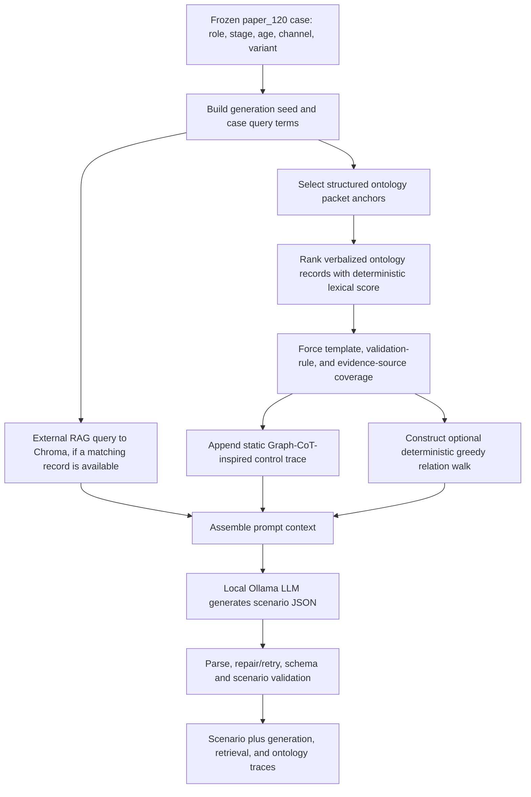

# Mode 4 Ontology-Text RAG: Formal Definition, Reproducibility Audit, and Reviewer Response

**Project:** PersonaShield Quest scenario-generation and evaluation engine  
**Ontology:** PSQ-SCO v9.1  
**Audit date:** 18 July 2026  
**Status:** Project-grounded technical and publication-methodology document

## 1. Purpose

This document answers the following methodological concerns about the four-condition scenario-generation experiment:

1. What does "selected subgraph" mean in the current engine?
2. What graph traversal algorithm is actually implemented?
3. Is that traversal reproducible?
4. Which embedding model is used, where is it used, and on what data was it trained?
5. How do domain mismatch and representation mismatch affect the experiment?
6. Does ontology verbalization produce natural language?
7. Can each generated output be traced to the exact sources retrieved for it?
8. How should source similarity, grounding/faithfulness, diversity, and ontology conformance be separated?
9. Is Condition 4 a true ontology embedding?
10. What result can the paper defend about Condition 3 versus Condition 4?

The answers below come from direct inspection of the implemented engine, the frozen all-live 1,440-output dataset, and the latest standardized evaluation. Academic sources justify the methodological distinctions; they do not replace the project audit.

## 2. Short Reviewer Answer

| Concern | Evidence-based answer |
|---|---|
| "Selected subgraph" is under-specified | Correct. The current system first selects ontology **records/documents**, not a formally induced RDF subgraph. It can then serialize an optional deterministic greedy relation walk. The preferred term is **retrieved ontology evidence packet**. Use **walk projection** only when the walk is actually included. |
| Graph traversal is unclear | The code performs a depth-limited, one-edge-at-a-time **greedy relevance walk**. It is not random and does not learn graph representations. Exact scoring and tie-breaking are defined in Section 6. |
| Traversal is not reproducible | Most ranking and tie-breaking are deterministic. One unordered Python `set` affected rule-anchor order; this audit replaced it with an ordered tuple and added a regression test. Full run reproducibility still requires frozen software, model, index, prompt, and seed metadata. |
| Embedding model is unclear | External Chroma retrieval does not explicitly configure an embedding function. Current source and installed Chroma 1.5.5 imply Chroma's local default `all-MiniLM-L6-v2`, but the historical output did not freeze the Chroma/model version. Ontology-text records themselves are **not embedded**; they are ranked lexically. LaBSE is used only for post-hoc diversity evaluation. |
| Domain/representation mismatch | The external corpus is 89.93% email and 97.35% English, while the experiment also evaluates SMS, voice, and age/role conditions. `all-MiniLM-L6-v2` is a general English sentence encoder, not a cybersecurity-ontology retriever. Ontology records are serialized symbolic structures, unlike its ordinary sentence-pair training data. |
| Verbalized ontology text can be unnatural | Correct. The implementation is deterministic field serialization, not a trained natural-language generator. The inspected export contains repeated labels/definitions, namespace artifacts such as `}comment`, file paths, and engineering placeholders. It should be described as **controlled ontology serialization**, not guaranteed fluent prose. |
| Outputs are not fully mapped to sources | Partly correct. File/source identifiers and compact previews are stored, but retrieval rank, cosine distance, exact chunk ID, embedding version, and claim-to-source attribution are absent. Presence of provenance fields is not evidence that generated claims are faithful to those sources. |
| Similarity, diversity, and conformance are blended | They must be reported separately. Retrieval relevance concerns query-source matching; faithfulness concerns output-source support; conformance concerns frozen case/ontology controls; diversity concerns variation among outputs. None is a substitute for pedagogical or cybersecurity quality. |
| Condition 4 is an ontology embedding | No. It is **ontology-to-text retrieval with deterministic lexical record ranking and an optional greedy relation walk**. It does not learn entity/relation vectors and is not a KGE, GraphRAG, DeepWalk, or full Graph-CoT implementation. |
| Condition 3 is best | The defensible statement is conditional: **Condition 3 was strongest under the present implementation and dataset on the secondary project-defined conformance index and relative diversity.** The primary method-invariant common-case F1 showed no significant four-method difference. No universal superiority claim is supported. |

## 3. Inspected Project Evidence

### 3.1 Implementation files

| Component | Project file | Function in the audit |
|---|---|---|
| Ontology parser and semantic packet | [`psq_sco_generation/ontology.py`](../psq_sco_generation/ontology.py) | Parses RDF/XML; selects templates, rules, and sources. |
| Ontology text corpus and walk | [`psq_sco_generation/ontology_text.py`](../psq_sco_generation/ontology_text.py) | Verbalizes records, ranks documents, creates static control trace and optional walk. |
| Four-mode orchestration | [`psq_sco_generation/engine.py`](../psq_sco_generation/engine.py) | Chooses external RAG and/or ontology context; calls LLM; writes traces. |
| Prompt assembly | [`psq_sco_generation/prompts.py`](../psq_sco_generation/prompts.py) | Places case, external RAG, packet, or ontology-text context in the prompt. |
| External RAG | [`rag_engine.py`](../rag_engine.py) | Queries Chroma or uses lexical JSONL fallback. |
| Evaluation diagnostics | [`three_layer_evaluation/scenario_checks.py`](../three_layer_evaluation/scenario_checks.py) | Computes control, provenance-field, contradiction, and project-defined conformance diagnostics. |
| Frozen generation outputs | [`output/paper120_live_recovered_final/20260714_031104/generated_scenarios`](../output/paper120_live_recovered_final/20260714_031104/generated_scenarios) | 12 files: 3 LLMs x 4 conditions x 120 cases. |
| Latest standardized evaluation | [`output/three_layer_eval_live_recovered_standard_no_bertscore/20260714_033519`](../output/three_layer_eval_live_recovered_standard_no_bertscore/20260714_033519) | Method summaries, diversity results, paired tests, reports, and row-level scores. |

### 3.2 Integrity identifiers

These hashes identify the files inspected after the deterministic rule-order correction:

| Artifact | SHA-256 |
|---|---|
| `personashield-psq-sco-v9.1.owl` | `EEF7E0E554042EB90008D753B9AD94C42DE99C7E5F5CABD569209C2BCDD0582F` |
| `psq_sco_generation/ontology.py` | `1D407C2B7664A718BC034686A25346CF73ECD46C7E5426F0A52354C26EB575C8` |
| `psq_sco_generation/ontology_text.py` | `218427DDEE34EA23CE19C9440351A7052ECE675D0AF6D0762E8912508B547188` |
| `psq_sco_generation/engine.py` | `B14EFF75A95EC85A773D048199A10F87E69E28FE1D68B14F385820325C764B30` |
| `psq_sco_generation/prompts.py` | `A7C2E796884EC907A98A3D439FBEDDE93FD3082CE03756B52C771040E74576AF` |
| `rag_engine.py` | `E1E1362D11B79966D4DFA09ACB11CB59534FDC2F560F8A61DAED00BE36A01981` |

The folder is not currently a Git repository, so file hashes are the available code-snapshot identifiers. A publication release should also provide a versioned archive or Git commit.

## 4. Exact Definition of the Four Conditions

The paper's condition numbering must remain stable. Older project documents sometimes called `ontology_text_rag` "Mode 3" because they described a three-mode subset. For the full experiment, use the following names only:

| Condition | Engine mode | External corpus retrieval | Ontology representation supplied to LLM | Correct description |
|---|---|---:|---|---|
| C1 | `prompt_only` | No | None | Prompt-engineered baseline using the frozen case controls and output schema. |
| C2 | `prompt_rag` | Yes, when a matching item is retrieved | None | Prompt plus external text RAG. |
| C3 | `ontology_prompt_rag` | Yes, when available | Structured semantic packet | Prompt plus external RAG plus directly serialized templates, required rules, evidence sources, `must_include`, and `must_exclude` constraints. |
| C4 | `ontology_text_rag` | Yes, when available | Retrieved ontology-to-text documents | Prompt plus external RAG plus lexically selected verbalized ontology records, a static control trace, and optionally a greedy walk. |

The comparison changes the **representation and delivery mechanism** of ontology knowledge. It does not compare a non-ontology system against a learned ontology embedding.

## 5. How Condition 4 Generates a Scenario



Step by step:

1. The engine reads one frozen case from `paper_120`. The same role, macro/micro stage, age group, channel, and fake/real variant are used across all four conditions and all three LLMs.
2. It builds a normal external RAG query from case fields such as role, channel, variant, knowledge type, interaction pattern, development focus, and age group.
3. Separately, `PSQSCOOntology.select_semantic_packet()` selects ontology template, rule, and evidence anchors.
4. `OntologyTextCorpus.retrieve()` creates a lexical query-term set from the case and packet.
5. It ranks all verbalized ontology records using the score in Section 6.2.
6. It forces one scenario-template record, one validation-rule record, and one evidence-source record into the context when available.
7. It adds a static, deterministic control trace inspired by the vocabulary of Graph-CoT.
8. It can add a depth-limited greedy relation walk.
9. The prompt contains the case instructions, external context if found, ontology-text context, and output schema.
10. The local LLM generates JSON, which is parsed and validated. Generation metadata and compact retrieval traces are added to the output.

Important: Graph-CoT as defined by Jin et al. alternates LLM reasoning, LLM-graph interaction, and graph execution. The PSQ trace is precomputed static context and does not implement that iterative loop. It may be described as **Graph-CoT-inspired**, not as Graph-CoT itself ([Jin et al., 2024](https://aclanthology.org/2024.findings-acl.11/)).

## 6. Formal Definition of Selection and Traversal

### 6.1 Graph and case notation

Let:

- `G = (V, E)` be the record graph parsed from the OWL/RDF/XML file.
- `V` be the set of parsed ontology records.
- `E` be the set of record-property-value assertions exposed by the lightweight parser.
- `c` be one frozen scenario case.
- `Q(c)` be the lower-cased query-term set for `c`.
- `A(c)` be the selected packet-anchor identifiers: templates, required rules, and evidence sources.
- `K = {scenario_template, validation_rule, evidence_source}`.
- `L` be the ontology-text document limit.

`Q(c)` contains channel, variant, role, stage, macro-stage, micro-stage, age group, knowledge type, expected attack type (or `legitimate`), and up to the first four learning-objective words.

### 6.2 Ontology-record ranking

For ontology record document `d`, define `H(d)` as the lower-cased concatenation of its title, serialized text, and relevance terms. The implemented score is:

```text
record_score(d, c)
  = 2 * SUM over q in Q(c) of I[q is a substring of H(d)]
  + 8 * I[source_id(d) is in A(c)]
  + 2 * I[type(d) is in K]
```

where `I[condition]` is 1 when the condition is true and 0 otherwise.

Selection procedure:

1. Discard records with score `<= 0`.
2. Sort by descending score.
3. Break ties by ascending `doc_id`.
4. Force the first ranked template, rule, and evidence record into the selected list.
5. Fill from the global ranking until `max(1, L - 2)` record documents are selected.
6. Append the static control trace.
7. Append the optional walk document.
8. Return only the first `L` documents.

This is deterministic lexical/field ranking. It is not vector retrieval, SPARQL basic-graph-pattern matching, a learned graph retriever, or an induced-subgraph algorithm.

### 6.3 Greedy relation-walk algorithm

Walk starting points are the first five packet anchor identifiers. For current code, the required-rule order is now frozen by `REQUIRED_RULE_IDS`.

For current node `u`, property `p`, and value `v`, the candidate edge text is formed from:

```text
p + v + label(v) + definition(v) + types(v)
```

The implemented edge score is:

```text
edge_score(u, p, v, c)
  = SUM over q in Q(c) of I[q is a substring of candidate_text(p, v)]
  + I[v identifies another parsed ontology record]
```

Candidate edges are sorted by:

1. descending `edge_score`,
2. ascending property name,
3. ascending property value.

The first candidate is chosen. With default `walk_depth = 2`, each start can contribute at most two edges and three visited records. If the selected value is a literal rather than a record identifier, the next lookup fails and that path terminates.

Exact pseudocode:

```text
INPUT: graph G, case c, start identifiers S, maximum depth h = 2
OUTPUT: ordered walk paths

for each start in first_five(S):
    current = start
    visited = empty set
    path = empty list

    for depth from 0 through h:
        if current is absent from V or current is in visited:
            stop this path

        mark current visited
        append current to path

        if depth equals h:
            stop this path

        candidates = all property-value pairs exposed for current
        score each candidate using edge_score
        sort by (-score, property_name, property_value)
        choose first candidate
        append chosen relation and value to path
        current = chosen value

    retain path if non-empty
```

### 6.4 Why this is not a random walk

A random walk samples a next node according to a probability distribution. DeepWalk, for example, samples truncated random walks and learns latent node representations from them ([Perozzi et al., 2014](https://research.google/pubs/deepwalk-online-learning-of-social-representations/)). The PSQ implementation always chooses the highest-scoring edge after deterministic tie-breaking and learns no vectors. Therefore:

- **Incorrect:** random-walk graph embedding.
- **Incorrect:** deterministic random walk.
- **Correct:** deterministic greedy relevance walk.

The legacy metadata value `deterministic_random_walk_graph_to_text` remains in historical/current output for backward compatibility. It must be treated as an alias, not as the scientific method name.

## 7. What "Selected Subgraph" Should Mean

### 7.1 Current implementation

The current term combines two different objects:

1. a ranked set of verbalized ontology records; and
2. an optional serialized walk through selected property-value relations.

A ranked document set has no required edge set and is therefore not, by itself, a graph. The walk may also terminate on a literal. Calling every selected packet a "subgraph" overstates the implementation.

### 7.2 Recommended operational definitions

Use these definitions in the paper and reports:

**Retrieved ontology evidence packet**

```text
D_L(c) = the ordered, length-limited set of ontology-derived text documents
         supplied to the LLM for case c.
```

**Walk projection**

```text
H(c) = (V_H, E_H)

V_H = parsed record identifiers actually visited by the greedy walk
E_H = the selected record-to-record property edges actually traversed
```

Literal properties can be recorded as attributes of visited records but should not be described as traversed graph nodes unless the representation explicitly models them as such.

**Selected subgraph** may be used only if the export records `V_H` and `E_H` and the walk was actually included in the generation prompt. A stricter future implementation could define a `k`-hop induced neighborhood around case-matched anchors, but that is not what the present engine does.

### 7.3 Frozen experiment reality

The frozen all-live Condition 4 data contain 360 rows. Every row contains exactly four ontology-derived context records:

| Document type | Total occurrences across 360 rows |
|---|---:|
| `scenario_template` | 360 |
| `validation_rule` | 360 |
| `evidence_source` | 360 |
| `graph_cot_trace` | 360 |
| `selected_subgraph_walk` | **0** |

The run used an ontology-text document limit of four. Because the code appends the static control trace before the walk and then slices to `L`, the walk was truncated from every evaluated prompt. Consequently, the completed experiment must not claim that Condition 4's observed results test the effect of graph traversal. It tests ontology-record verbalization plus the static control trace.

The current CLI default is five documents, which can include the walk. A future traversal ablation must be newly generated and labeled as a different experiment.

## 8. Reproducibility Assessment

### 8.1 Deterministic components

- Case set and condition labels are frozen.
- Record scoring is deterministic substring matching.
- Record tie-breaking is deterministic by `doc_id`.
- Edge scoring is deterministic.
- Edge tie-breaking is deterministic by property and value.
- Walk depth is fixed by argument, currently defaulting to 2.
- The required rule-anchor order is now a fixed tuple; a unit test protects it.

### 8.2 Components that prevent exact end-to-end replay

1. Historical outputs do not store the exact Chroma version, embedding model revision, ONNX file hash, or index-build fingerprint.
2. The external retriever drops Chroma distances/ranks from exported traces.
3. Some recovery rows lack nested `ontology_text_trace.documents`, although their top-level RAG records remain present.
4. The local LLM runtime, model digest/quantization, Ollama version, hardware, and all decoding parameters must be frozen together.
5. Retrieval exposure was not identical: 242 of 360 Condition 4 rows had at least one external RAG item and 118 had none.
6. The merged recovery dataset combines runs with heterogeneous retrieval availability. Method effects are therefore partly entangled with retrieval dose.
7. The folder has no Git commit identifier.

### 8.3 Minimum reproducibility record for the next run

Store per run:

```json
{
  "ontology_sha256": "...",
  "case_set_sha256": "...",
  "code_commit_or_archive_sha256": "...",
  "prompt_version": "...",
  "schema_version": "...",
  "ollama_version": "...",
  "llm_name": "...",
  "llm_digest": "...",
  "quantization": "...",
  "temperature": 0.0,
  "seed": 42,
  "chroma_version": "...",
  "embedding_model": "sentence-transformers/all-MiniLM-L6-v2",
  "embedding_revision": "...",
  "embedding_artifact_sha256": "...",
  "index_collection_id": "...",
  "index_manifest_sha256": "...",
  "distance_metric": "cosine",
  "top_k": 1,
  "ontology_document_limit": 5,
  "walk_depth": 2
}
```

PROV-O provides a standard vocabulary for representing entities, activities, agents, derivation, and use relations and is suitable for the provenance ledger ([W3C PROV-O](https://www.w3.org/TR/prov-o/)).

## 9. Embedding Model: Exact Role and Limitations

### 9.1 External RAG embedding

`rag_engine.py` creates/gets a Chroma collection without passing an explicit embedding function. Chroma's official documentation states that the default is `all-MiniLM-L6-v2` when no embedding function is supplied ([Chroma documentation](https://docs.trychroma.com/docs/embeddings/embedding-functions)). The currently installed project package is Chroma 1.5.5, whose local implementation identifies:

```text
model: all-MiniLM-L6-v2
artifact SHA-256: 913d7300ceae3b2dbc2c50d1de4baacab4be7b9380491c27fab7418616a16ec3
```

The model card states that it maps sentences/paragraphs to 384-dimensional vectors, was contrastively fine-tuned on more than one billion general sentence pairs, and truncates input beyond 256 word pieces ([official model card](https://huggingface.co/sentence-transformers/all-MiniLM-L6-v2)). Sentence-transformer retrieval is grounded in the Sentence-BERT architecture ([Reimers and Gurevych, 2019](https://aclanthology.org/D19-1410/)) and the compressed MiniLM family ([Wang et al., 2020](https://papers.nips.cc/paper_files/paper/2020/hash/3f5ee243547dee91fbd053c1c4a845aa-Abstract.html)).

However, the frozen generation outputs do not record Chroma/model versions or the collection's bound embedding configuration. Therefore the precise publication wording is:

> The source code used Chroma without an explicit embedding-function argument. Under the inspected Chroma 1.5.5 environment, this resolves to the local all-MiniLM-L6-v2 default. Because the historical run metadata did not freeze the Chroma version, model revision, or index manifest, the exact embedding artifact used by every recovered run cannot be independently reconstructed from the output files alone.

### 9.2 Ontology-text selection does not use embeddings

Condition 4's ontology records are not added to Chroma and are not encoded by MiniLM. They are selected in memory by the lexical score in Section 6.2. Therefore the project contains two distinct retrieval mechanisms:

| Evidence source | Retrieval mechanism | Embedding used? |
|---|---|---:|
| External JSONL corpus | Chroma cosine search, with lexical fallback | Yes in Chroma path; expected MiniLM default |
| PSQ-SCO ontology-text records | Deterministic lexical score plus fixed bonuses | No |

### 9.3 Evaluation embedding is separate

The latest diversity evaluation uses LaBSE to embed generated scenarios and compute within-condition semantic diversity. LaBSE is an **evaluation representation**, not the generation retriever and not an ontology embedding. This distinction must appear in every method table.

## 10. Domain and Representation Mismatch

### 10.1 External corpus imbalance

The latest dataset audit reports:

| Corpus fact | Value |
|---|---:|
| Selected JSONL files | 23 |
| Raw records before caps | 87,661 |
| Records retained after caps | 29,731 |
| Chroma-indexed records | 28,728 |
| Exact duplicates skipped | 1,003 |
| Email records | 26,737 (89.93%) |
| SMS records | 2,154 (7.24%) |
| Voice records | 840 (2.83%) |
| English records | 28,942 (97.35%) |
| Thai records | 789 (2.65%) |

The experiment asks one general English sentence encoder and a strongly email/English-weighted index to support email, SMS, voice, role, stage, age, and multilingual design. BEIR shows that dense retrieval performance can degrade across domains and that BM25 remains a strong zero-shot baseline; retrieval generalization must therefore be measured rather than assumed ([Thakur et al., 2021](https://datasets-benchmarks-proceedings.neurips.cc/paper/2021/hash/65b9eea6e1cc6bb9f0cd2a47751a186f-Abstract-round2.html)).

### 10.2 Ontology serialization mismatch

`all-MiniLM-L6-v2` was trained largely on natural sentence pairs from general sources. The ontology representation contains identifiers, class names, relation names, compact engineering statements, and provenance fields. Even if ontology documents were embedded in a future version, this would create a representation mismatch between natural language training data and symbolic/controlled ontology text.

### 10.3 Recommended mitigation

1. Explicitly configure and freeze the embedding model and revision.
2. Build human relevance judgments (`qrels`) for a stratified sample across channel, variant, role, and stage.
3. Compare BM25, MiniLM dense retrieval, and a hybrid/reranked system using Recall@k, MRR, and nDCG@k.
4. Apply metadata filters before retrieval rather than retrieving globally and filtering afterward.
5. Evaluate channel-specific results, especially voice and SMS.
6. Evaluate multilingual retrieval separately; do not infer it from English performance.
7. Test a cybersecurity/domain-adapted encoder only as a new, separately reported condition.
8. Hold retrieval dose constant across conditions when estimating causal method effects.

## 11. Ontology Verbalization Quality

### 11.1 What the engine currently does

The engine uses hand-written templates to concatenate:

- identifier,
- label,
- definition,
- type,
- selected properties/values,
- provenance and relevance terms.

This is deterministic and auditable, but it is not a learned graph-to-text system. The inspected corpus export contains repeated label/definition/comment material, XML namespace artifacts such as `}comment`, local file paths, and engineering placeholders. Compact prompting can truncate each document to a short preview, which may remove context required to interpret a relation.

### 11.2 Why fluency cannot be assumed

NaturalOWL distinguishes simple axiom-by-axiom controlled verbalization from fluent, coherent, multi-sentence text and reports gains from domain-dependent linguistic resources ([Androutsopoulos et al., 2013](https://arxiv.org/abs/1405.6164)). Guideline-based OWL label research similarly shows that heterogeneous labels require linguistic analysis and systematic naming conventions ([Fliedl et al., 2010](https://doi.org/10.1016/j.datak.2009.08.004)). Graph-to-text research also treats faithfulness to the input graph as a separate problem from fluency ([Hashem et al., 2023](https://aclanthology.org/2023.inlg-main.8/)).

### 11.3 Correct paper wording

Use:

> The ontology was converted into deterministic controlled text records. This representation preserves identifiers and selected properties for auditability but is not guaranteed to be fluent natural language. The method is therefore described as ontology serialization/verbalization, not unrestricted ontology-to-natural-language generation.

Do not use:

- "natural-language ontology documents" without qualification;
- "fluent ontology verbalization";
- "semantic graph embedding";
- "learned graph-to-text transformation."

### 11.4 Engineering corrections for a new run

1. Parse XML expanded names correctly (`{namespace}localName`) before verbalization.
2. Exclude `label`, `definition`, and `comment` from generic property repetition.
3. Remove machine-local paths and engineering placeholders from prompt text.
4. Use predicate-specific templates and a controlled lexicon.
5. Preserve untruncated source records in the audit ledger even when prompts use compact text.
6. Evaluate fluency, semantic adequacy, and graph faithfulness separately with human raters.

## 12. Source Mapping and Provenance

### 12.1 What is currently recorded

The output can retain:

- source file/dataset,
- retrieval tier,
- ontology source identifier,
- ontology document type,
- title,
- compact text preview,
- ontology strategy label,
- case/model/mode metadata.

This is useful audit information. KILT emphasizes evaluating downstream output and provenance together rather than treating generated text alone as sufficient ([Petroni et al., 2021](https://aclanthology.org/2021.naacl-main.200/)).

### 12.2 What is not recorded

The frozen outputs do not consistently retain:

- exact external document/chunk identifier,
- original untruncated retrieved text,
- rank,
- cosine distance or normalized similarity,
- embedding model/revision,
- index manifest/version,
- retrieval threshold,
- a mapping from each generated claim/field to supporting source IDs,
- an entailment/faithfulness judgment for each claim.

In addition, 279 of 360 Condition 4 rows include nested ontology-text document details, while 81 recovery rows lack those nested details. All 360 rows retain the four ontology-derived records in the top-level RAG context, so this is an export-consistency problem rather than evidence that those 81 prompts lacked ontology context.

### 12.3 Required evidence ledger

For each generated scenario, store:

```json
{
  "scenario_id": "...",
  "case_id": "...",
  "condition": "ontology_text_rag",
  "retrieval_query": "...",
  "retrieved_items": [
    {
      "source_id": "...",
      "source_uri_or_file": "...",
      "chunk_id": "...",
      "rank": 1,
      "distance": 0.0,
      "similarity": 1.0,
      "retrieval_backend": "chroma_cosine|lexical|ontology_record_ranker",
      "retrieval_score_definition": "...",
      "content_sha256": "...",
      "full_text": "..."
    }
  ],
  "claim_source_map": [
    {
      "scenario_field": "red_flags[0]",
      "claim": "...",
      "supporting_source_ids": ["..."],
      "support_status": "supported|partially_supported|unsupported|not_applicable",
      "reviewer": "human|model-id"
    }
  ]
}
```

RAGAS and ARES explicitly separate context relevance, answer/output faithfulness, and answer relevance, supporting this multi-part evaluation rather than one combined grounding score ([Es et al., 2024](https://aclanthology.org/2024.eacl-demo.16/); [Saad-Falcon et al., 2024](https://aclanthology.org/2024.naacl-long.20/)).

## 13. Separate the Evaluation Constructs

### 13.1 Required metric families

| Construct | Scientific question | Appropriate evidence/metrics | Current project status |
|---|---|---|---|
| Retrieval relevance/similarity | Did the retriever return sources relevant to the case query? | Human qrels; Recall@k, Precision@k, MRR, nDCG@k; logged rank/distance | Not yet validly evaluated; Chroma rank/distance absent. |
| Retrieval coverage | Did each case receive the intended number/type of context records? | retrieval hit rate; source-type coverage; dose distribution | Partly available from traces. |
| Source faithfulness/attribution | Are generated claims supported by retrieved sources? | Claim-source annotation; entailment/faithfulness; citation precision/recall | Not currently measured. |
| Case/control conformance | Does output match frozen role, stage, age, channel, variant, attack type, and schema? | Exact-match rates; contradiction checks; case-oracle precision/recall/F1 | Implemented as automated diagnostics. |
| Ontology trace/control conformance | Are required ontology trace fields present and controls followed? | Explicit rule coverage; SHACL/reasoner validation; project-defined trace diagnostic | Partly implemented; current score is project-defined, not KGE semantics. |
| Output-set diversity | Are outputs within a method semantically/lexically varied? | Embedding diversity; Self-BLEU; human content-diversity rating | Implemented with LaBSE and Self-BLEU; not a quality score. |
| Scenario quality | Is content pedagogically effective, cyber-realistic, usable, and safe? | Human/LLM PCUE rubric with agreement and calibration | Requires separate Layer 2/human validation. |
| Efficiency | What resources does generation require? | latency, retries, tokens, memory, energy/cost | Partly logged. |

### 13.2 Clarify current project-defined metrics

**`grounding_completeness`** currently computes the proportion of six metadata/provenance fields that are present:

```text
source_id, source_title, evidence_role, provenance_record,
retrieval_mode, source_record_id
```

It should be renamed in publications to **provenance-field completeness**. A score of 1.0 means the fields were found, not that the retrieved source was relevant or that the generated scenario was faithful.

**`ontology_semantic_scope`** currently computes:

```text
0.60 * structural_trace_presence
+ 0.25 * frozen_case_control_adherence
+ 0.15 * rule_based_non_contradiction
```

It should be called **ontology-trace/control conformance diagnostic**. It is not an EL embedding, KGE score, formal reasoner result, semantic similarity score, or universal quality measure. The code docstring has been corrected accordingly.

**`overall_conformance`** is an author-defined weighted diagnostic retained for backward compatibility and sensitivity analysis. It is useful for internal comparison only when its components and coefficients are fully disclosed. It must not be presented as a standardized quality score.

**Embedding diversity** is `1 - mean pairwise cosine similarity` over LaBSE embeddings of generated scenarios within a set. Higher means greater representation-space dispersion. It does not measure correctness or source relevance.

**Self-BLEU** measures lexical overlap among generated samples; lower generally indicates less repetition. Research warns that automatic diversity metrics may not align with human content-diversity judgments and must not replace quality assessment ([Tevet and Berant, 2021](https://aclanthology.org/2021.eacl-main.25/)).

## 14. What the Frozen Results Actually Show

### 14.1 Study unit

```text
120 frozen cases x 4 conditions x 3 local LLMs = 1,440 outputs
```

The recovered final dataset contains live LLM outputs for all 1,440 condition-model-case combinations. Each method summary contains 360 outputs.

### 14.2 Method means

| Condition | Common-case concept F1 (primary) | Exact control match | Contradiction-free | Provenance-field completeness | Ontology-trace/control diagnostic | Project-defined overall conformance |
|---|---:|---:|---:|---:|---:|---:|
| C1 Prompt only | 0.966667 | 1.000000 | 1.000000 | 0.481019 | 0.400000 | 0.774106 |
| C2 Prompt + external RAG | 0.966553 | 0.988889 | 1.000000 | 0.782407 | 0.399653 | 0.818125 |
| C3 Structured ontology packet + RAG | 0.966239 | 0.994444 | 1.000000 | 1.000000 | **0.899826** | **0.886013** |
| C4 Ontology-text RAG | 0.966313 | 0.986111 | 0.997222 | 1.000000 | 0.864149 | 0.849054 |

The primary method-invariant common-case F1 produced a case-clustered Friedman result of `n = 120`, statistic `5.7000`, `p = 0.127154`. No method difference is established at alpha 0.05 on that primary outcome. The small numerical differences should not be interpreted as meaningful rankings.

### 14.3 Diversity means

| Condition | LaBSE embedding diversity (higher = more varied) | Self-BLEU (lower = less repetitive) |
|---|---:|---:|
| C1 Prompt only | 0.186521 | 0.884561 |
| C2 Prompt + external RAG | 0.228861 | 0.810563 |
| C3 Structured ontology packet + RAG | **0.233875** | **0.790605** |
| C4 Ontology-text RAG | 0.230664 | 0.805884 |

These are relative set-diversity diagnostics under this sample. They do not establish scenario correctness or educational effectiveness.

### 14.4 Retrieval exposure in Condition 4

| Condition 4 context status | Rows |
|---|---:|
| At least one external RAG item | 242 |
| No external RAG item | 118 |
| Four ontology-derived items | 360 |
| Included walk document | 0 |

Therefore Condition 4 is not a constant-dose combination of external RAG and ontology text. For 118 rows it is effectively prompt plus ontology-text evidence only. Future causal comparisons should stratify by retrieval hit or hold the external context count constant.

## 15. Defensible Interpretation of Condition 3

### 15.1 What can be claimed

> Under the current PSQ-SCO v9.1 ontology, paper_120 case design, external corpus, local LLMs, prompts, retrieval settings, and automated diagnostics, Condition 3 (structured ontology packet plus RAG) achieved the highest project-defined ontology-trace/control conformance and overall conformance scores and the strongest relative output-set diversity. Condition 4 ranked below Condition 3 on those secondary diagnostics. The primary method-invariant common-case F1 did not show a statistically significant four-condition difference.

### 15.2 Why Condition 3 may have performed better here

This is a mechanism-based interpretation, not a proven causal conclusion:

1. Condition 3 exposes `must_include` and `must_exclude` constraints directly.
2. It preserves structured identifiers and rule groupings instead of compressing them into awkward text previews.
3. Condition 4's evaluated four-document limit omitted its greedy walk.
4. Condition 4 includes noisy serialization artifacts and compact truncation.
5. Condition 4's external retrieval exposure varied by row.

### 15.3 What cannot be claimed

Do not state that:

- Condition 3 is universally the best ontology-RAG method;
- ontology grounding caused improved pedagogy or learning gain;
- Condition 4 tested graph traversal in the frozen experiment;
- Condition 4 is a true ontology embedding;
- a higher trace/conformance score proves source faithfulness;
- diversity proves quality;
- the results generalize to different ontologies, corpora, embeddings, languages, or model sizes.

## 16. Reviewer-Response Text

### R1. Selected subgraph was under-specified

**Response:** We agree. Code inspection showed that the original term conflated a ranked ontology-document packet with an optional relation walk. We now define the ranked object as `D_L(c)`, the **retrieved ontology evidence packet**. A graph object `H(c) = (V_H, E_H)` is reported only when record nodes and traversed record-to-record edges are explicitly exported. The completed experiment included no walk documents, so its results are described as ontology-record verbalization plus a static control trace, not selected-subgraph traversal.

### R2. Graph traversal was not reproducible

**Response:** We now specify the query-term construction, record score, edge score, traversal depth, starting anchors, stopping conditions, and lexicographic tie-breaks. We also replaced an unordered rule-ID set with a fixed ordered tuple and added a unit test. Exact end-to-end replay still requires frozen embedding/index and local-model runtime metadata, which is listed as a limitation and next-step requirement.

### R3. Embedding model and training background were unclear

**Response:** External Chroma retrieval used no explicitly configured embedding function. In the inspected Chroma 1.5.5 environment this resolves to `all-MiniLM-L6-v2`, a 384-dimensional general sentence encoder contrastively fine-tuned on more than one billion sentence pairs. The model is used only for external corpus retrieval. Ontology-text selection is lexical; LaBSE is used only for diversity evaluation. Historical output files did not freeze the Chroma/model revision, so this is reported as a reproducibility limitation rather than silently inferred as exact historical fact.

### R4. Domain and representation mismatch were not addressed

**Response:** The source corpus is 89.93% email and 97.35% English, and the default encoder is a general English sentence model. The ontology serialization includes symbolic identifiers and relation statements. We now identify both domain and representation mismatch, require channel/language-stratified retrieval evaluation, and propose BM25, dense, and hybrid comparisons against human relevance judgments.

### R5. Ontology verbalization may be unnatural

**Response:** We agree and have changed the terminology to **controlled ontology serialization/verbalization**. Current records are deterministic and auditable but not guaranteed fluent. Inspected artifacts contain namespace, duplication, local-path, and truncation noise. A future run will clean XML local names, deduplicate linguistic fields, use predicate-specific templates, and evaluate fluency and graph faithfulness separately.

### R6. Outputs were not clearly mapped to retrieved sources

**Response:** Existing traces preserve source-file and ontology identifiers but omit ranks, distances, exact chunks, and claim-level attribution. We therefore do not interpret provenance-field completeness as faithfulness. A source ledger with immutable content hashes and a claim-source support map is specified for the next experiment.

### R7. Source similarity, diversity, and conformance were not separated

**Response:** The revised framework reports six independent families: retrieval relevance, retrieval coverage, source faithfulness, case/ontology conformance, output-set diversity, and human scenario quality. Project-defined diagnostics are labeled as such and no longer described as standardized semantic or quality metrics.

### R8. Condition 4 should not be called a true ontology embedding

**Response:** Correct. Knowledge-graph embedding methods learn continuous representations of graph entities and relations ([Wang et al., 2017](https://doi.org/10.1109/TKDE.2017.2754499)). Condition 4 learns no entity/relation vectors. We now call it **ontology-to-text retrieval with deterministic record ranking and an optional greedy relation walk**.

### R9. Condition 3 should be reported as best only under the present setup

**Response:** Correct. Condition 3 led the secondary project-defined conformance and diversity diagnostics in this experiment, while the primary common-case F1 showed no significant four-condition difference. We have replaced universal wording with a bounded statement tied to the present ontology, corpus, prompts, local LLMs, sample, and automated metrics.

## 17. Publication-Ready Method Wording

> Four generation conditions were compared using the same 120 frozen case specifications and three local open-weight LLMs. Condition 1 used prompt engineering only. Condition 2 added retrieval from the external scenario corpus. Condition 3 added a structured PSQ-SCO semantic packet containing selected templates, required validation rules, evidence-source identifiers, and explicit inclusion/exclusion controls. Condition 4 supplied ontology-derived controlled text records selected by a deterministic lexical ranker. The Condition 4 record score assigned two points for each case-query term present, an eight-point packet-anchor bonus, and a two-point type bonus for templates, rules, or evidence sources. Ties were resolved lexicographically. The implementation could append a depth-two deterministic greedy relation walk, but the completed experiment's four-document limit excluded the walk; consequently, Condition 4 results evaluate ontology-record verbalization and a static control trace rather than graph traversal.

> External corpus retrieval used Chroma without an explicitly configured embedding function. In the inspected Chroma 1.5.5 environment, the default is `all-MiniLM-L6-v2`; however, the historical output metadata did not freeze the Chroma version, embedding revision, or index fingerprint. The ontology-derived records were not embedded in Chroma and were selected using deterministic lexical matching. LaBSE was used only for post-hoc semantic-diversity measurement. Condition 4 is therefore not described as a knowledge-graph or ontology embedding method.

## 18. Publication-Ready Result Wording

> Condition 3 produced the highest secondary project-defined ontology-trace/control conformance (`0.8998`), overall conformance (`0.8860`), and relative output-set diversity (LaBSE embedding diversity `0.2339`; Self-BLEU `0.7906`, lower is more diverse) under the present experimental configuration. Condition 4 produced corresponding values of `0.8641`, `0.8491`, `0.2307`, and `0.8059`. However, the primary method-invariant common-case F1 values were nearly identical across conditions (`0.9662` to `0.9667`), and the case-clustered Friedman test did not establish a significant four-condition difference (`n = 120`, `p = 0.1272`). These findings support the narrower conclusion that direct structured ontology controls were more effective than the current ontology-verbalization implementation on the secondary diagnostics used here. They do not establish universal superiority, improved learner outcomes, or a benefit from graph traversal.

## 19. Publication-Ready Limitation Wording

> The experiment has four important limitations. First, the external corpus was heavily weighted toward English email content, limiting claims for SMS, voice, and multilingual generation. Second, external retrieval used an implicit Chroma embedding configuration whose exact historical version and index fingerprint were not preserved. Third, ontology serialization was deterministic but not linguistically optimized and included representation noise. Fourth, retrieval relevance, source faithfulness, structural conformance, and output diversity were measured as separate or partially implemented constructs; no automated metric alone was treated as evidence of pedagogical effectiveness. The completed Condition 4 run also excluded the optional relation walk, so graph-traversal effects remain unevaluated.

## 20. Required Next Experiment

### Phase A: repair and freeze the retrieval representation

1. Clean ontology XML names and verbalization templates.
2. Export immutable ontology record/triple IDs and hashes.
3. Explicitly configure the embedding model, revision, normalization, and distance function.
4. Export the Chroma collection manifest and every retrieved rank/distance.
5. Use identical external retrieval dose across C2-C4 or stratify by retrieval hit.

### Phase B: evaluate retrieval independently

1. Draw a stratified set of case queries across 3 channels x 2 variants x 5 roles and difficulty bands.
2. Have at least two cybersecurity-aware annotators judge source relevance.
3. Report agreement and adjudication.
4. Compare BM25, MiniLM, and hybrid/reranked retrieval using Recall@k, MRR, and nDCG@k.
5. Select the retriever on development queries; report final performance on held-out queries.

### Phase C: isolate ontology representation effects

Use a factorial/ablation design with a fixed external context:

```text
A: prompt only
B: prompt + fixed external evidence
C: B + structured semantic packet
D: B + cleaned ontology record text
E: B + cleaned ontology text + exported greedy walk
F: B + true learned KGE/graph retriever, only if separately implemented
```

### Phase D: validate generated content

1. Measure case/control conformance automatically.
2. Annotate claim-source faithfulness.
3. Rate PCUE quality with human experts and calibrated multi-judge support.
4. Measure diversity separately.
5. Report latency/cost separately.
6. Use held-out cases and pre-register primary outcomes before comparison.

## 21. Reference Quality Note

The user requested Q1/Q2/Q3 evidence. Quartiles apply to journals and vary by database, category, and year; they do not validly apply to conference papers. This document therefore uses:

- Q1/Q2 journal articles for knowledge-graph embedding, ontology verbalization, and hallucination/faithfulness foundations;
- peer-reviewed papers from premier NLP/ML conferences for RAG, retrieval benchmarks, provenance, and evaluation methods;
- official software/model documentation only for implementation facts such as Chroma's default embedding model.

Before final submission, verify each journal's quartile for the exact year, category, and ranking system required by the target institution.

## 22. References

1. Androutsopoulos, I., Lampouras, G., and Galanis, D. (2013). *Generating Natural Language Descriptions from OWL Ontologies: the NaturalOWL System*. Journal of Artificial Intelligence Research, 48, 671-715. [DOI](https://doi.org/10.1613/jair.4017), [open manuscript](https://arxiv.org/abs/1405.6164). Journal article; JAIR is commonly Q1 in AI, subject to year/category verification.
2. Es, S., James, J., Espinosa Anke, L., and Schockaert, S. (2024). *RAGAs: Automated Evaluation of Retrieval Augmented Generation*. EACL 2024 System Demonstrations. [ACL Anthology](https://aclanthology.org/2024.eacl-demo.16/). Peer-reviewed conference paper; journal quartile not applicable.
3. Fliedl, G., Kop, C., Voehringer, J., and Winkler, C. (2010). *Guideline based evaluation and verbalization of OWL class and property labels*. Data & Knowledge Engineering, 69(4), 331-342. [DOI](https://doi.org/10.1016/j.datak.2009.08.004). Journal article; reported Q2 in recent Scopus categories, verify target year/category.
4. Hashem, T., Wang, W., Wijaya, D. T., Ali, M. E., and Li, Y.-F. (2023). *Generating Faithful Text From a Knowledge Graph with Noisy Reference Text*. INLG 2023. [ACL Anthology](https://aclanthology.org/2023.inlg-main.8/). Peer-reviewed conference paper; journal quartile not applicable.
5. Ji, Z. et al. (2023). *Survey of Hallucination in Natural Language Generation*. ACM Computing Surveys, 55(12). [DOI](https://doi.org/10.1145/3571730). Q1 survey journal, subject to year/category verification.
6. Jin, B. et al. (2024). *Graph Chain-of-Thought: Augmenting Large Language Models by Reasoning on Graphs*. Findings of ACL 2024. [ACL Anthology](https://aclanthology.org/2024.findings-acl.11/). Peer-reviewed conference paper; journal quartile not applicable.
7. Lewis, P. et al. (2020). *Retrieval-Augmented Generation for Knowledge-Intensive NLP Tasks*. NeurIPS 2020. [Proceedings](https://proceedings.neurips.cc/paper/2020/hash/6b493230205f780e1bc26945df7481e5-Abstract.html). Peer-reviewed premier conference paper; journal quartile not applicable.
8. Petroni, F. et al. (2021). *KILT: a Benchmark for Knowledge Intensive Language Tasks*. NAACL 2021. [ACL Anthology](https://aclanthology.org/2021.naacl-main.200/). Peer-reviewed conference paper; journal quartile not applicable.
9. Perozzi, B., Al-Rfou, R., and Skiena, S. (2014). *DeepWalk: Online Learning of Social Representations*. KDD 2014. [Author/Google Research page](https://research.google/pubs/deepwalk-online-learning-of-social-representations/). Peer-reviewed premier conference paper; journal quartile not applicable.
10. Reimers, N., and Gurevych, I. (2019). *Sentence-BERT: Sentence Embeddings using Siamese BERT-Networks*. EMNLP-IJCNLP 2019. [ACL Anthology](https://aclanthology.org/D19-1410/). Peer-reviewed conference paper; journal quartile not applicable.
11. Saad-Falcon, J., Khattab, O., Potts, C., and Zaharia, M. (2024). *ARES: An Automated Evaluation Framework for Retrieval-Augmented Generation Systems*. NAACL 2024. [ACL Anthology](https://aclanthology.org/2024.naacl-long.20/). Peer-reviewed conference paper; journal quartile not applicable.
12. Tevet, G., and Berant, J. (2021). *Evaluating the Evaluation of Diversity in Natural Language Generation*. EACL 2021. [ACL Anthology](https://aclanthology.org/2021.eacl-main.25/). Peer-reviewed conference paper; journal quartile not applicable.
13. Thakur, N., Reimers, N., Rueckle, A., Srivastava, A., and Gurevych, I. (2021). *BEIR: A Heterogeneous Benchmark for Zero-shot Evaluation of Information Retrieval Models*. NeurIPS 2021 Datasets and Benchmarks. [Proceedings](https://datasets-benchmarks-proceedings.neurips.cc/paper/2021/hash/65b9eea6e1cc6bb9f0cd2a47751a186f-Abstract-round2.html). Peer-reviewed benchmark paper; journal quartile not applicable.
14. Wang, Q., Mao, Z., Wang, B., and Guo, L. (2017). *Knowledge Graph Embedding: A Survey of Approaches and Applications*. IEEE Transactions on Knowledge and Data Engineering, 29(12), 2724-2743. [DOI](https://doi.org/10.1109/TKDE.2017.2754499). Q1 journal in relevant computer-science categories, subject to year/category verification.
15. Wang, W. et al. (2020). *MiniLM: Deep Self-Attention Distillation for Task-Agnostic Compression of Pre-Trained Transformers*. NeurIPS 2020. [Proceedings](https://papers.nips.cc/paper_files/paper/2020/hash/3f5ee243547dee91fbd053c1c4a845aa-Abstract.html). Peer-reviewed premier conference paper; journal quartile not applicable.
16. W3C (2013). *PROV-O: The PROV Ontology*. [W3C Recommendation](https://www.w3.org/TR/prov-o/). Normative technical standard, not a journal paper.
17. Chroma (current documentation). *Embedding Functions: Default all-MiniLM-L6-v2*. [Official documentation](https://docs.trychroma.com/docs/embeddings/embedding-functions). Software implementation source, not academic evidence.
18. Sentence Transformers (current model card). *all-MiniLM-L6-v2*. [Official model card](https://huggingface.co/sentence-transformers/all-MiniLM-L6-v2). Model provenance/configuration source, not a peer-reviewed journal article.

## 23. Final Terminology Checklist

| Avoid | Use instead |
|---|---|
| ontology embedding | ontology-to-text retrieval / controlled ontology serialization |
| selected subgraph, when no edges are exported | retrieved ontology evidence packet |
| random walk | deterministic greedy relevance walk |
| Graph-CoT | static Graph-CoT-inspired control trace |
| grounding completeness | provenance-field completeness |
| semantic scope score | ontology-trace/control conformance diagnostic |
| source similarity, when no distances/qrels are recorded | retrieval exposure or retrieval hit rate |
| Condition 3 is best | Condition 3 was strongest on specified secondary diagnostics under the present setup |
| diversity means quality | diversity is a separate set-level property |

This terminology keeps the scientific claims aligned with what the current code and frozen evidence actually support.
